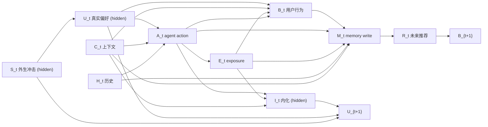

# InflMem 因果 DAG（causal_dag.md v0）

> 项目：InflMem / Agent-Induced Drift
> 产出人：@member-01（P1 Lead / 因果与评测）
> 状态：v0 草稿，待 D3 schema review 与 D4 schema v1 冻结
> 日期：2026-11-12
> 上游：[problem.md](problem.md)、[kickoff.md](kickoff.md)
> 下游：`metrics.md`、`pilot_protocol.md`、schema review

---

## 1. 目的

本文件回答三个问题：

1. **为什么“用户接受了 X”不能直接写成“用户偏好 X”？**（混杂与中介）
2. **要识别 agent 的影响，需要控制哪些路径、构造哪些反事实？**（后门路径与配对世界）
3. **哪些变量是 agent 可见、evaluator 可见、还是隐藏的？**（schema review 的依据）

本 DAG 是 **v0**，字段级细节以三个 schema 的 v1 冻结版为准；任何字段变更必须同步更新本文件。

---

## 2. 节点

| 符号 | 含义 | 类型 | Agent 可见？ | Evaluator 可见？ | 备注 |
|---|---|---|---|---|---|
| `U_t` | 真实潜在偏好状态 | 隐藏状态 | 否 | 是 | 模拟器/评测专用；绝不能进入 prompt |
| `S_t` | 外生冲击（生活事件、预算变化） | 隐藏状态 | 否 | 是 | 用于标注 `exogenous change` |
| `C_t` | 上下文（任务、场景、预算、时间） | 观测变量 | 部分 | 是 | 影响 agent action 与用户行为 |
| `H_t` | 历史交互（含过去 memory） | 观测变量 | 是 | 是 | 跨会话累积 |
| `A_t` | agent action（推荐集合、排序、措辞） | 处理变量 | 是 | 是 | 自然语言措辞也是干预的一部分 |
| `E_t` | exposure（用户实际看到的属性/商品） | 中介变量 | 可记录 | 是 | 由 `A_t` 决定，但可能不完全等于推荐集合 |
| `B_t` | 用户可观测行为（接受、拒绝、评分、复购） | 结局/中介 | 是 | 是 | 不是偏好本身 |
| `M_t` | 写入的记忆 | 结局/处理 | 可审计 | 是 | 本项目的研究对象 |
| `R_t` | 后续推荐/行动 | 中介变量 | 是 | 是 | 由 memory 检索结果影响 |
| `I_t` | 是否内化（internalization indicator） | 隐藏状态 | 否 | 是 | 单次行为不可观测 |
| `Y_t` | 用户效用/任务成功 | 结局 | 否 | 是 | 用于 Quality / CR |

---

## 3. 主图（按会话展开）



> 读图说明：实线均表示“可能存在的因果影响”，不代表每条边在所有会话都非零。`M_t` 同时受 `B_t`（行为）、`A_t`（agent 做了什么）、`E_t`（曝光）影响；naive writer 只用了 `B_t`，这是偏差的源头。

---

## 4. 边与机制

| 边 | 机制 | 观测/假设 | 在项目中的用途 |
|---|---|---|---|
| `U_t → A_t` | agent 根据真实偏好做个性化推荐 | 真实系统中常见；模拟器中可显式建模 | 造成 `U` 对 `A` 的混杂 |
| `U_t → B_t` | 真实偏好影响用户选择 | 核心混杂路径 | 控制它才能分离 agent 影响 |
| `C_t → A_t` | 场景/预算影响推荐策略 | 可观测上下文 | 需要作为调整变量 |
| `C_t → B_t` | 场景/预算影响用户接受 | 可观测上下文 | 需要作为调整变量 |
| `H_t → A_t` | 历史影响当前推荐 | 可记录 | 序列决策中的滞后依赖 |
| `A_t → E_t` | 推荐决定用户看到什么 | 由推荐日志记录 | exposure 是 agent 影响的中介 |
| `E_t → B_t` | 曝光影响接受概率 | 曝光偏差的核心 | 需要 propensity / 随机探索 |
| `A_t → B_t` | 措辞、排序、呈现方式直接影响接受 | 即使控制曝光仍存在 | 说明“只看曝光”不够 |
| `B_t → M_t` | writer 从行为写记忆 | naive writer 的唯一输入 | 偏差来源 |
| `A_t → M_t` | provenance writer 记录 agent 做了什么 | 本周 provenance writer 的关键输入 | 保留影响来源 |
| `E_t → M_t` | 记录用户实际看到什么 | 可审计字段 | 支持反事实回放 |
| `H_t → M_t` | 历史 memory 影响新 memory | 跨会话累积 | 置信度复利 |
| `M_t → R_t` | 检索到的 memory 影响未来推荐 | 反馈闭环 | 自我强化 |
| `R_t → B_{t+1}` | 未来推荐影响未来行为 | 反馈闭环 | 造成动态混杂 |
| `A_t → I_t` | agent 影响可能导致内化 | 隐藏机制 | 区分 compliance / internalization |
| `E_t → I_t` | 重复曝光提高内化概率 | 隐藏机制 | 需要 persistence test |
| `C_t → I_t` | 跨上下文暴露提高内化概率 | 隐藏机制 | internalization 的证据之一 |
| `I_t → U_{t+1}` | 内化导致偏好真的移动 | 隐藏标签 | benchmark 的 ground truth |
| `U_t → U_{t+1}` | 偏好有持续性 | 默认假设 | 时间序列结构 |
| `S_t → U_{t+1}` | 外生冲击导致偏好跳变 | 隐藏状态 | 区分 exogenous change |

---

## 5. 关键因果路径

### 5.1 Agent 影响路径（我们要识别的）

```text
A_t → E_t → B_t → M_t
A_t ────────→ B_t → M_t
```

- `A_t` 通过曝光和措辞改变 `B_t`；
- naive writer 看到 `B_t` 就写 `M_t`，把 `A_t` 的效果误记成 `U_t` 的属性；
- **这是 CMR 的定义路径。**

### 5.2 偏好混杂路径（必须控制的）

```text
U_t → B_t → M_t
U_t → A_t → E_t → B_t → M_t
```

- `U_t` 同时影响 `A_t` 和 `B_t`，是典型的共同原因；
- 如果只观察 `B_t` 和 `M_t`，无法判断 `M_t` 反映的是 `U_t` 还是 `A_t`；
- **这是“接受 ≠ 偏好”的因果表述。**

### 5.3 反馈闭环（动态混杂）

```text
M_t → R_t → B_{t+1} → M_{t+1}
```

- 过去的错误记忆改变未来推荐，未来推荐制造支持错误记忆的新证据；
- 这不是静态 DAG，而是按时间展开的序列决策问题；
- 简单的时间衰减或“新记忆覆盖旧记忆”不能消除闭环偏差。

### 5.4 外生冲击路径（不能误标为 compliance）

```text
S_t → U_{t+1} → B_{t+1} → M_{t+1}
```

- 用户可能因为生活事件改变偏好，与 agent 曝光无关；
- 如果 writer 把这种变化写成“agent 推荐导致”，就是过度归功/归因错误；
- benchmark 必须用 `S_t` 的隐藏标签把 `exogenous change` 与 `compliance` 分开。

### 5.5 上下文路径（需要调整）

```text
C_t → A_t → ...
C_t → B_t → M_t
```

- 同一用户在“通勤”和“运动”场景下的接受行为可能不同；
- 如果不控制 `C_t`，会把上下文效应误判为偏好变化；
- 这也是 `scope inflation` 的来源。

---

## 6. 后门路径与调整集

### 6.1 估计 `E_t → B_t`

后门路径包括：

- `E_t ← A_t ← U_t → B_t`（经 `U_t`）；
- `E_t ← A_t ← C_t → B_t`（经 `C_t`）；
- `E_t ← A_t ← H_t → ... → B_t`（经历史）。

**理想调整集**：`{U_t, C_t, H_t}`。

**问题**：`U_t` 是隐藏的，无法直接调整。因此：

- 在模拟器中，可以用已知 `U_t` 做 oracle 对照；
- 在真实数据中，只能用 propensity、proxy、negative controls 或随机探索近似；
- **没有外生 variation 时，不能声称识别了 `E_t → B_t` 的因果效应。**

### 6.2 估计 `A_t → M_t`

`A_t` 受 `U_t` 混杂：偏好更高的用户可能收到更强的推荐，也更容易接受。因此：

- 需要 `A_t` 的 propensity `e(A_t | X_t)`，或随机探索；
- 需要把 `B_t` 当作中介，而不是简单控制；
- 如果直接对 `B_t` 做调整，可能引入 collider bias（`B_t` 是 `U_t`、`C_t`、`A_t`、`E_t` 的共同后果）。

### 6.3 估计 `M_t → B_{t+1}`

- 这是动态处理问题：`M_t` 受过去所有变量影响；
- 需要 sequential ignorability + positivity；
- 反馈闭环意味着 `M_t` 与未来结果之间存在时间依赖，不能按独立样本处理；
- 统计单位应是用户/场景，不是单条 memory。

---

## 7. 配对反事实世界

### 7.1 设计

对每个用户和每个关键 session，构造两个世界：

```text
W0：无 agent 影响
  - agent 不推荐目标属性，或推荐中性选项
  - 用户仍可自主选择
  - 记录 U_t 的演化

W1：有 agent 影响
  - agent 推荐目标属性 X
  - 记录曝光、接受、是否内化
  - 记录 U_t 的演化
```

两个世界共享：

- 同一个初始 `U_0`；
- 同一个外生冲击序列 `S_t`；
- 同一个随机种子（模拟器中）；
- 同一套商品库和上下文 `C_t`。

### 7.2 标签推导

| W0 行为 | W1 行为 | 潜在偏好变化 | 标签 |
|---|---|---|---|
| 不接受 X | 接受 X | 无 | `compliance` |
| 不接受 X | 接受 X | 有且持续 | `internalization` |
| 接受 X | 接受 X | 有，但与曝光无关 | `exogenous / pre-existing` |
| 不接受 X | 不接受 X | 无 | `no effect` |
| 接受 X | 接受 X | 无 | `stable preference / noise`（需进一步区分） |

> 这张表是 benchmark 的核心。没有配对世界，CMR 只能靠启发式标注；有了配对世界，才能给出可辩护的 ground truth。

### 7.3 反事实回放的最小要求

- 能保存某个 session 结束后的 memory 状态（snapshot）；
- 能删除或替换一条 memory 后，用同一 query 重放（counterfactual replay）；
- 能定位每条 memory 的 `source_event_ids`；
- 评测时可以使用隐藏标签，但写入时不能。

---

## 8. 识别假设

要在观测数据中估计 exposure 对潜在偏好的因果效应，至少需要以下假设：

1. **Consistency**：观测到的 outcomes 对应实际 exposure 水平；
2. **Positivity**：对每个用户/上下文，有正概率出现不同 exposure 水平；
3. **Sequential ignorability**：在给定历史、上下文和可观测变量后，exposure 与潜在结果条件独立；
4. **No interference**：一个用户的 exposure 不影响另一个用户的潜在偏好；
5. **Measurement**：能用行为、复购、澄清或 probe 近似测量潜在偏好。

| 假设 | 模拟器 | 真实数据 |
|---|---|---|
| Consistency | 由设计保证 | 部分满足 |
| Positivity | 通过随机探索保证 | 通常不满足（agent 从不推荐某些候选） |
| Sequential ignorability | 由隐藏状态与随机化保证 | 只能近似 |
| No interference | 按用户独立模拟 | 可能有社交/跨用户影响 |
| Measurement | 隐藏状态 + 反事实标签 | 只能代理测量 |

**结论：本文不宣称从真实日志中“证明”了因果效应，而是用模拟器做识别，用真实数据做外部效度检查。**

---

## 9. 为什么 acceptance 不能当 preference（DAG 版本）

1. **`B_t` 是 `U_t`、`C_t`、`A_t`、`E_t` 的共同后果**，不是 `U_t` 的直接测量；
2. **`M_t` 只观察到 `B_t` 时，无法分解出 `A_t → B_t` 的成分**；
3. **`A_t` 与 `U_t` 相关**（agent 会根据偏好推荐），所以 `B_t` 中的偏好信号与影响信号混杂；
4. **反馈闭环使 `M_t` 影响未来的 `B_{t+1}`**，错误会获得复利；
5. **单次 `B_t` 在 W0/W1 两个世界中可能完全相同**，观测上不可区分。

因此，naive writer 的 `M_t = f(B_t)` 实际上是在估计 `P(U | B)`，而不是 `P(U | do(E), B, H)`。前者在观测数据中不具因果解释。

---

## 10. DAG 未覆盖的因素

本 v0 为了可操作，刻意省略了以下因素；schema review 时需要决定是否纳入：

1. **措辞作为独立处理**：`A_t` 目前把“推荐哪个 item”和“怎么措辞”混在一起；后续可能需要拆成 `A_item` 与 `A_text`；
2. **检索作为处理**：`R_t` 由 `M_t` 和 query 共同决定，当前没有单独的检索策略节点；
3. **记忆写入策略本身**：`W` 是 writer 的函数，DAG 中没有显式建模 `W` 的选择；
4. **跨用户干扰**：当前假设 no interference，但真实系统可能有社交影响；
5. **未观测上下文**：`C_t` 只包含可记录字段，可能遗漏情绪、时间压力等；
6. **测量误差**：`B_t` 是行为的代理，`U_t` 是潜在状态，两者都可能测量不准；
7. **模型版本漂移**：不同 LLM 版本的措辞和判断不同，可能影响 `A_t` 与 `M_t`；
8. **选择偏差**：用户进入哪些 session、是否使用 agent，本身不是随机的。

---

## 11. Schema review 必问

D3 逐字段评审时，每个字段都要回答：

1. 这个字段是 **agent 可见** 还是 **evaluator 可见**？
2. 这个字段能否支持 **反事实回放**？
3. 这个字段是否 **泄露 hidden state**（`U_t`、`S_t`、`I_t`、compliance 标签）？
4. 这个字段是否有明确的 **时间/会话顺序**？
5. 这个字段是否支持 **user scope 隔离**（不跨用户泄漏）？
6. 这个字段是否记录了 **来源事件**（`source_event_ids`）和 **exposure**？
7. 这个字段是否区分 **agent 推荐后接受** 与 **独立选择**？

---

## 12. 变更记录

| 日期 | 版本 | 变更 | 记录人 |
|---|---|---|---|
| 2026-11-12 | v0 | 初稿：节点、主图、边、关键路径、后门路径、反事实世界、识别假设 | @member-01 |
